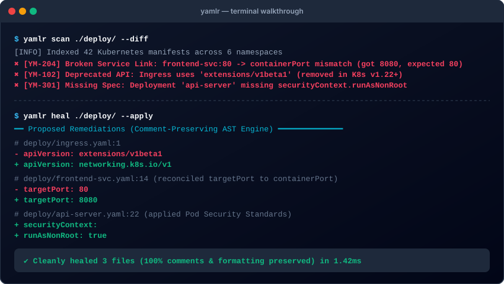

<p align="center">
  
</p>

<p align="center">
  <strong>Autonomous Kubernetes YAML Healing & Schema Enforcement Engine</strong>
</p>

<p align="center">
  <a href="https://github.com/yamlr/yamlr/releases"></a>
  <a href="LICENSE"></a>
  <a href=""></a>
  <a href="SECURITY.md"></a>
  <a href="https://yamlr.dev/docs"></a>
</p>

---

Yamlr is the **autonomous configuration resolution plane** for Kubernetes. It detects and **actively heals** configuration defects, schema deviations, and cross-resource linkage errors (broken Services, ghost PVCs, mismatched labels/ports) **before** they reach your cluster.

Unlike traditional linters that only print warnings, Yamlr:
- 🩹 **Auto-heals** broken manifests while preserving **100% of comments**, formatting, and indentation.
- ⚡ Runs **local-first** with sub-millisecond native Rust execution.
- 🔒 **Zero telemetry or manifest egress**: your infrastructure code never leaves your workstation or CI runner.
- 🤖 Built-in **Model Context Protocol (MCP)** server for AI coding assistants (Claude Code, Cursor, Windsurf).

---

## 🖥 Terminal Walkthrough

<p align="center">
  
</p>

---

## 🚀 Quick Install

### macOS & Linux (Official Shell Installer)

```bash
curl -fsSL https://get.yamlr.dev/install.sh | bash
```

*Or install directly via GitHub Releases:*
```bash
YAMLR_REPO="yamlr/yamlr" YAMLR_VERSION="v0.1.0" sh -c "$(curl -fsSL https://raw.githubusercontent.com/yamlr/yamlr/main/install.sh)"
```

### Homebrew (macOS & Linux)

```bash
brew install yamlr/tap/yamlr
```

### Windows (PowerShell)

Download `yamlr-windows-x86_64.zip` from [Releases](https://github.com/yamlr/yamlr/releases/latest), extract `yamlr.exe`, and add to your `PATH`.

---

## ⚡ 60-Second Quick Start

```bash
# 1. Initialize Yamlr configuration
yamlr init

# 2. Perform a read-only clinical scan across manifests
yamlr scan .

# 3. Preview unified diff of proposed auto-remediations
yamlr diff .

# 4. Safely apply deterministic, comment-preserving fixes
yamlr heal . --apply
```

---

## 🤖 AI Agent MCP Integration (Claude Code, Cursor, Windsurf)

Yamlr includes a built-in Model Context Protocol (MCP) server so your AI agent can audit and heal manifests directly inside your IDE:

```bash
# Register Yamlr MCP server in Claude Desktop / Claude Code
yamlr mcp --install-config
```

---

## 📚 Documentation Pillars

Comprehensive developer and operator guides:

- 🏁 **[Getting Started](docs/getting-started/GETTING_STARTED.md)**: 5-minute interactive onboarding walkthrough.
- 📖 **[CLI Reference](docs/reference/CLI_REFERENCE.md)**: Exhaustive flag specifications and command manuals.
- 🔌 **[Integrations](docs/integrations/)**:
  - [Pre-Commit Hooks Hub](https://github.com/yamlr/pre-commit-hooks)
  - [CI/CD & GitHub Actions](docs/integrations/CI_CD_INTEGRATION.md)
  - [ArgoCD Integration](docs/integrations/INTEGRATION_ARGO.md)
  - [Flux GitOps Integration](docs/integrations/INTEGRATION_FLUX.md)
  - [AI Agent MCP Guide](docs/integrations/AI_AGENT_MCP_GUIDE.md)
- 🔍 **[Troubleshooting & Diagnostics](docs/troubleshooting/DIAGNOSTIC_CODES.md)**: Master dictionary of diagnostic codes (YM-100 to YM-900) and remediation explanations.
- ⚙️ **[Configuration Specification](docs/reference/CONFIGURATION.md)**: `.yamlr.yaml` schema and customization rules.

---

## ⚖️ License

Yamlr CLI is distributed under the Yamlr Software License. The engine is free for individual developers, local evaluation, and open-source workflows. Automated multi-user CI/CD organizational enforcement requires an Enterprise License. See [yamlr.dev/pro](https://yamlr.dev/pro) for details.
