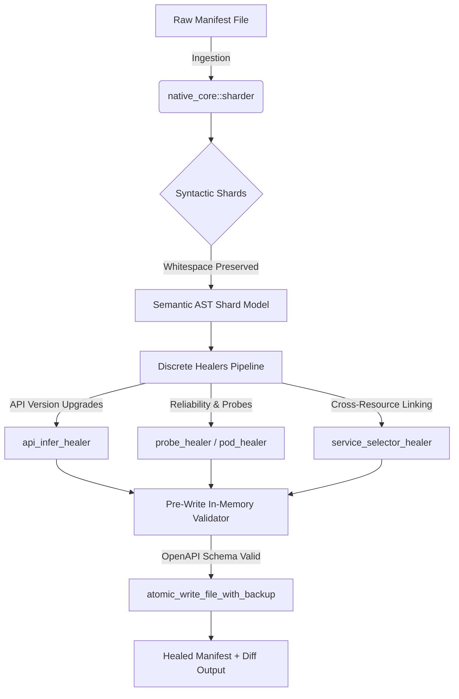

# 🗺️ Yamlr System Architecture (The Founder's Map)
**"How it Works" for Technical and Non-Technical Stakeholders**

> **The Golden Rule of Debugging:** You don't need to fix the code. You just need to know **WHICH** module is responsible so you can direct development precisely.

---

## 🏭 Part 1: The "Factory" Analogy
Think of Yamlr as a **High-Precision Manifest Restoration & Validation Engine**.

1. **Ingestion & Sharding:** Manifests arrive. Raw streams are broken into whitespace- and indentation-preserving AST shards without loss.
2. **Deterministic Healing Pipeline:** Discrete healers inspect shards, repair YAML syntax, correct deprecated Kubernetes APIs, reconcile cross-resource contracts, and enforce reliability patterns.
3. **In-Memory Invariant Verification:** Every transformed document is validated against official Kubernetes OpenAPI schemas and YAML parser invariants before touching disk.
4. **Forensic Vault & Diff Rendering:** If applying, changes are written atomically with zero-byte protection and diffs are rendered via Myers/LCS token alignment.

---

## 📁 Part 2: The Core Module Directory (Native Rust Engine)

### The Orchestration & Write Path (`native_core/src/cli/`)
| Module File | Role | Description |
| :--- | :--- | :--- |
| `native_core/src/cli/heal_cmd.rs` | **Healing CLI Orchestrator** | High-level CLI entry point for manifest discovery, multi-document stream dispatch, and metric collection. |
| `native_core/src/cli/heal_writer.rs` | **Atomic Writer & Invariants** | Performs in-memory schema validation, atomic file swapping with temporary files, and backup rollback. |
| `native_core/src/cli/diff_viewer.rs` | **Myers / LCS Diff Viewer** | Calculates word- and token-level diffs using Longest Common Subsequence so insertions do not desync line alignment. |
| `native_core/src/cli/scan_cmd.rs` | **Diagnostics Scanner** | Walks workspaces, scans Kubernetes manifests against schema rules, and formats SARIF/JSON outputs. |
| `native_core/src/cli/evidence_cmd.rs`| **Evidence Packager** | Aggregates SHA-256 digests and audit journals into forensic compliance dossiers. |

### The AST & Parsing Core (`native_core/src/`)
| Module File | Role | Description |
| :--- | :--- | :--- |
| `native_core/src/sharder.rs` | **Lossless Token Sharder** | Tokenizes YAML into line-by-line semantic shards, preserving all comments, indentation, and blank lines. |
| `native_core/src/structurer.rs` | **AST Graph Structurer** | Reassembles flat shards into hierarchical `SemanticManifest` and `SemanticNode` trees. |
| `native_core/src/pipeline.rs` | **Stage Runner** | Sequences discrete healers deterministically across all documents. |
| `native_core/src/schemas/bundler.rs` | **Schema Registry** | Bundles official distilled OpenAPI schemas for Kubernetes v1.21 through v1.37. |

### The Healers (`native_core/src/healers/`)
| Healer Module | Target Rule | Responsibility |
| :--- | :--- | :--- |
| `api_infer_healer.rs` | API-001..005 | Automatically migrates deprecated Kubernetes API versions to current stable equivalents. |
| `quote_numeric_healer.rs`| SYN-001..003 | Enforces quotes on scalar values prone to YAML 1.1 boolean or octal misinterpretation. |
| `service_selector_healer.rs` | NET-001..004 | Reconciles mismatched Service selectors against Deployment and Pod labels. |
| `probe_healer.rs` | REL-001..003 | Corrects probe path errors and missing port mappings. |
| `daemonset_update_healer.rs` | REL-012 | Safely modernizes DaemonSet update strategies when explicitly configured. |
| `cis_security_healer.rs` | SEC-001..008 | Pod security standards hardening (rootless, read-only root filesystems). |

---

## 🛠️ Part 3: Quick Troubleshooting Flowchart

1. **Syntax or Indentation issue?** -> Look at `native_core/src/sharder.rs` and `native_core/src/structurer.rs`.
2. **Schema validation false positive?** -> Check `native_core/src/schemas/bundler.rs` or `native_core/src/schemas/nested.rs`.
3. **Healing rule not applying?** -> Check the specific healer class in `native_core/src/healers/` and ensure it is registered in `native_core/src/pipeline.rs`.
4. **Write failure or safety abort?** -> Inspect `native_core/src/cli/heal_writer.rs`.
