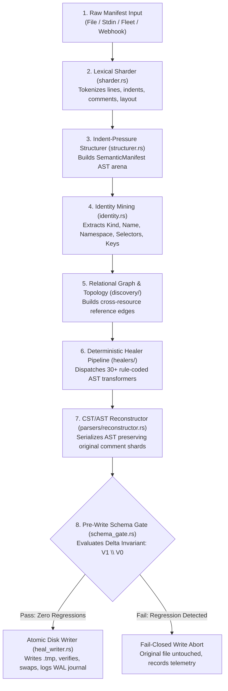
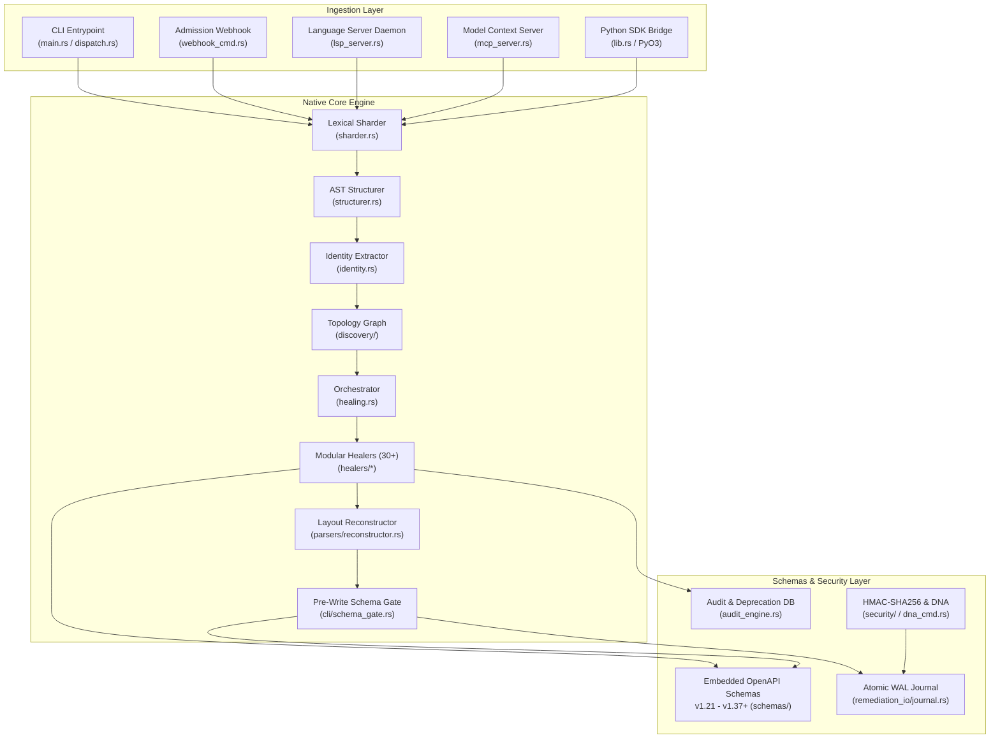

# Yamlr Architectural Blueprint & System Reference
**The Native Kubernetes Configuration Resolution Plane**
*Classification: Confidential / Engineering Due Diligence Documentation*

---

## 1. Executive Summary & Core Value Proposition

Yamlr is not a traditional static linter, nor is it a generative LLM wrapper. It is a **deterministic, layout-preserving Kubernetes configuration resolution engine** built entirely in native Rust (`native_core`).

### The Core Problem in Enterprise Kubernetes
Modern cloud-native engineering teams face a systemic operational paradox:
1. **Configuration Drift & Outages**: Over 60% of Kubernetes production outages stem from malformed manifests—mismatched Service selectors, deprecated API versions, broken probe timings, unquoted octal strings, and unmanaged Secret/ConfigMap key references.
2. **The "Validation vs. Remediation" Gap**: Existing tools (Kubeval, Kube-linter, Conftest, OPA Gatekeeper) detect errors and fail CI builds, forcing developers to manually research and edit YAML.
3. **The Parser Dilemma**: Standard YAML parsers (`pyyaml`, `serde_yaml`, `yaml.v3`) discard comments, strip developer annotations, and re-order keys. As a result, safe automated remediation was historically considered an intractable engineering challenge.

### The Yamlr Breakthrough (The Moat)
Yamlr solves this with a **Dual-Layer Concrete/Abstract Syntax Tree (CST/AST)** and an **In-Memory Schema Gate Oracle**:
* **100% Comment & Layout Preservation**: Every developer comment, blank line, and formatting rhythm is preserved bit-for-bit.
* **Pre-Write Delta Safety Gate ($V_1 \setminus V_0$)**: Fixes are evaluated against embedded Kubernetes OpenAPI schemas in memory. If an auto-fix introduces even a single new structural regression, the engine fails closed and leaves the file untouched.
* **Hermetic & Air-Gapped**: Runs completely offline with embedded, zstd-compressed OpenAPI schemas spanning Kubernetes v1.21 through v1.37+.
* **Sub-15ms Startup**: High-throughput native Rust binary with zero external runtime dependencies.

```
┌────────────────────────────────────────────────────────────────────────┐
│                        THE RESOLUTION PLANE PARADIGM                   │
│                                                                        │
│   1. Read Manifest  ──► 2. CST Sharding   ──► 3. Semantic Structuring  │
│                                                       │                │
│   6. Atomic Write   ◄── 5. Schema Delta   ◄── 4. Cross-Resource        │
│      & WAL Journal         Gate (V1 \ V0)        Healer Pipeline       │
└────────────────────────────────────────────────────────────────────────┘
```

---

## 2. End-to-End Execution Pipeline

Every manifest processed by Yamlr (`scan`, `heal`, `fmt`, `fix`, `migrate`, or the Webhook daemon) passes through an 8-stage deterministic pipeline:



### Stage 1: Lexical Sharding & Boundary Isolation (`native_core/src/sharder.rs`)
* **Input**: Raw UTF-8 bytes from disk, stdin, or network stream.
* **Responsibility**: Scans documents line-by-line without invoking a destructive DOM deserializer. Enforces hard safety limits: 10 MB maximum file size, 999 multi-document delimiter boundaries, and immediate rejection of NULL-byte binary inputs.
* **Data Model (`NativeShard`)**: Captures raw line content, indentation depth, comment strings (`# ...`), leading blank lines (`layout_sequence`), trailing layout, document boundary markers (`---`), and line endings (`\n` vs `\r\n`).

### Stage 2: Indent-Pressure AST Structuring (`native_core/src/structurer.rs`)
* **Responsibility**: Transforms the stream of flat `NativeShard` tokens into a hierarchical `SemanticManifest` tree containing `SemanticNode` arenas.
* **Algorithm**: Uses an **indent-pressure vertical stack**. Rather than failing on invalid indentation, the structurer measures relative indent deltas, cleanly associating sequence items (`- `), key-value pairs, and multiline scalar blocks with their correct logical parent node.

### Stage 3: Workspace Identity Mining (`native_core/src/identity.rs`)
* **Responsibility**: Extracts resource identities across single files or multi-thousand-file repositories.
* **Extractors**: 22 modular extractors isolate:
  * Workload metadata (`apiVersion`, `kind`, `metadata.name`, `metadata.namespace`).
  * Pod template labels and Service `spec.selector` key-value pairs.
  * Container port definitions and Service `targetPort` bindings.
  * ConfigMap and Secret data keys (`data`, `binaryData`, `stringData`).
  * RBAC RoleBindings, ServiceAccounts, and PersistentVolumeClaims.

### Stage 4: Topological Graph Resolution (`native_core/src/discovery/`)
* **Responsibility**: Links discrete manifests into an in-memory directed relational dependency graph.
* **Capabilities**:
  * Detects missing dependencies (e.g., a Deployment mounting a Secret that does not exist in the namespace).
  * Calculates blast radius metrics for GitOps repositories.
  * Deterministically re-orders multi-document streams so prerequisite resources (Namespaces, CRDs, ServiceAccounts) are applied before workloads.

### Stage 5: Deterministic Healing Pipeline (`native_core/src/healing.rs`)
The core transformation engine runs modular, idempotent AST repair stages partitioned into three discrete sub-pipelines:
1. **In-Manifest Single-Doc Repairs (`healing_in_manifest.rs`)**:
   * Property typo correction via Levenshtein edit distance (`typo_healer.rs`).
   * Kubernetes enum casing and typo normalization (`enum_healer.rs`).
   * Misnested field relocation (e.g., lifting misplaced `securityContext` or `resources`) (`structural_healer.rs`).
   * Missing `apiVersion` inference from resource `kind` (`api_infer_healer.rs`).
   * Resource limit string sanitation and binary SI unit repairs (`resource_sanitizer.rs`, `memory_unit_healer.rs`).
   * Octal and boolean string quote enforcement (`quote_numeric_healer.rs`).
   * Probe timeout and port validation (`probe_healer.rs`).
2. **Policy Shield & Prophetic Auditor (`healing_cross_resource.rs`)**:
   * CIS Kubernetes Benchmark and Pod Security Standards (PSS Restricted) hardening (`cis_security_healer.rs`).
   * Deprecation audit scanning against embedded Kubernetes lifecycle database.
3. **Cross-Resource Referential Alignment (`healing_cross_resource.rs`)**:
   * Synchronizing Service selectors to Deployment labels (`selector_healer.rs`).
   * Aligning Service ports to named container ports (`port_healer.rs`).
   * Resolving ConfigMap and Secret key references (`data_key_healer.rs`).
   * Ingress backend service and port alignment (`ingress_port_healer.rs`).
   * RBAC role and ServiceAccount subject binding (`rbac_healer.rs`).

### Stage 6: Layout & Comment Reconstructor (`native_core/src/parsers/reconstructor.rs`)
* **Responsibility**: Serializes the transformed `SemanticManifest` AST back into standard Kubernetes YAML text.
* **Layout Preservation**: Nodes that were not modified by healers are output verbatim from their underlying `NativeShard`. For modified nodes, surrounding developer comments and indentation styles are preserved, while necessary key quotes (`"y"`, `"yes"`, `"on"`) are applied to satisfy YAML 1.2 standards.

### Stage 7: Pre-Write Schema Gate Oracle (`native_core/src/cli/schema_gate.rs`)
* **The Zero-Failure Enforcement Gate**: Evaluates the candidate healed document against the official embedded Kubernetes OpenAPI schema using the **Delta Rule ($V_1 \setminus V_0$)**.
* **Formula**:
  $$\text{Regressions} = V_{\text{healed}} \setminus V_{\text{original}}$$
  * $V_0$: Violations present in the original input document.
  * $V_1$: Violations present in the candidate healed document.
* If any violation appears in $V_1$ that did not exist in $V_0$ (unknown fields, null structures, scalar/object type mismatches, empty selectors, selector/label mismatches), the gate **fails closed**. The write is aborted, and telemetry logs the blocked regression.

### Stage 8: Atomic File Writer & WAL Journal (`native_core/src/cli/heal_writer.rs`)
* **Responsibility**: Guarantees zero-byte data corruption protection on disk.
* **Execution**:
  1. Writes candidate output to a temporary staging file (`.tmp`).
  2. Creates a safety backup of the original manifest (`.bak`, unless `--no-backup` is passed).
  3. Performs an atomic filesystem rename/replace operation.
  4. Records the before-and-after cryptographic SHA-256 state into the Write-Ahead Log (WAL) journal (`remediation_io/journal.rs`), enabling instant rollbacks via `yamlr rollback <TX_ID>`.

---

## 3. High-Level Connective Module Topology



---

## 4. Key Architectural Differentiators (The M&A Moat)

| Capability | Legacy Linters (Kube-linter, Conftest) | LLM Code Assistants (Copilot, Cursor) | Yamlr Native Resolution Plane |
| :--- | :--- | :--- | :--- |
| **Actionability** | Read-only warnings; manual fixing required | Suggests generative diffs; requires human review | Fully automated, deterministic auto-remediation |
| **Comment Preservation** | N/A (Cannot write) | Discards or hallucinates comments | Bit-for-bit lossless layout & comment preservation |
| **Determinism** | Deterministic (Read-only) | Non-deterministic (Probabilistic sampling) | 100% deterministic mathematical state transitions |
| **Offline / Air-Gapped** | Yes (Rule-based) | No (Requires cloud API connection) | Yes (Hermetic binary, embedded v1.21–v1.37 schemas) |
| **Execution Latency** | 500ms – 3,000ms (Go / Rego) | 2,000ms – 10,000ms (LLM inference) | <15ms startup, 20–40ms per document (Rust LTO) |
| **Safety Invariant** | Non-destructive (Read-only) | High hallucination / syntax corruption risk | Pre-Write Schema Gate ($V_1 \setminus V_0$) fails closed |
| **Cross-Resource Graph** | Limited or non-existent | Single-file prompt context limits | Full multi-repository relational identity graph |

---

## 5. Planetary Distribution & Developer Habit (The Wedge)

Yamlr's business defensibility relies on embedding the engine across developer workflows before manifests ever reach production:

1. **Local Developer Pre-Commit**: Instant sub-second hook (`.pre-commit-hooks.yaml`) running `yamlr-fmt` and `yamlr-fix`.
2. **CI/CD Quality Gate**: Official GitHub Action (`yamlr/yamlr-action@v1`) publishing SARIF reports directly into GitHub Code Scanning.
3. **IDE Integration**: Lightweight VS Code extension communicating via stdio JSON-RPC Language Server Protocol (`yamlr lsp`).
4. **AI Coding Agent MCP**: Native Model Context Protocol server (`yamlr mcp`) enabling agents (Claude Desktop, Cursor, Antigravity) to query schemas and execute verified fixes.
5. **In-Cluster Admission Control**: Validating and mutating webhook daemon (`yamlr webhook`) blocking misconfigured resources at cluster runtime.
6. **The "Intel Inside" Embedding**: C-ABI dynamic library (`libyamlr.so`, `yamlr.dll`) and PyO3 Python bindings allowing 3rd-party platforms (Datadog, Snyk, Backstage) to embed the engine directly.

---

## 6. Codebase Modularity & Due Diligence Hygiene

* **Strict Line-Count Guardrails**: 100% of Rust source files in `native_core/src/` adhere to the `< 500 lines` modularity constraint (0 files exceeding threshold).
* **Test Automation Rigor**: 821 automated tests (757 unit tests + 64 integration tests across 13 suites) passing with 0 failures.
* **Golden Bundle Invariants**: Verified byte-identical stability against major upstream Kubernetes bundles (`cert-manager`, `calico`, `prometheus`, `argo-rollouts`).
* **Zero CVE Vulnerabilities**: Clean dependency inventory audited via `cargo-deny` with zero open high-risk CVEs.
